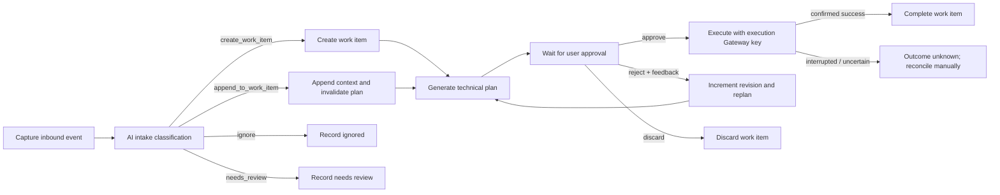

# Samwise Assistant

Samwise is a single-user personal assistant that turns incoming information into approved, executable work.

Version 1 accepts manual text and email messages from configured IMAP accounts in the password-protected Blazor UI. Inputs do **not** create work items directly. They enter the same canonical inbound-event pipeline that future Microsoft Teams and Todoist connectors can also use:



The authoritative state lives in PostgreSQL. AI calls are one-shot and stateless; Samwise stores the exact rendered prompt, structured result, selected playbook snapshot, tool-catalog versions, work item revision, and approved plan needed for audit and continuation. An interrupted execution is never retried automatically because its external effects may already have happened.

## Technology

- .NET 10 and Blazor Interactive Server
- LumexUI with Tailwind CSS 4 for the web interface
- ASP.NET Core Identity password hashing and cookie authentication for one owner account
- PostgreSQL with Marten for Samwise documents
- MailKit for read-only IMAP ingestion with password or app-password authentication
- one versioned work item aggregate containing its plans, plan reviews, comments, discard metadata, and exact tool-catalog snapshots
- PostgreSQL with EF Core migrations for Identity
- .NET Aspire for local orchestration
- Microsoft Agent Framework `ChatClientAgent`
- Official OpenAI .NET connector pointed at Codex CLI API Gateway

## Projects

- [Samwise.Domain](src/Samwise.Domain/README.md) — work item, plan, playbook, agent-stage configuration, inbound-event, comment, and invocation state
- [Samwise.Logic](src/Samwise.Logic/README.md) — externally triggered MediatR use cases, reusable workflow services, public read specifications, playbook steering, prompt rendering, and UI-facing models
- [Samwise.Infrastructure.Persistence.Marten](src/Samwise.Infrastructure.Persistence.Marten/README.md) — only Marten registration and Samwise document mappings
- [Samwise.Infrastructure.AgentRuntimes](src/Samwise.Infrastructure.AgentRuntimes/README.md) — provider-neutral endpoint configuration plus the standard OpenAI/Agent Framework implementation of `IAgentRuntime`
- [Samwise.Infrastructure.CodexGateway](src/Samwise.Infrastructure.CodexGateway/README.md) — only the Gateway-specific model-capability and versioned MCP tool catalogs
- [Samwise.Infrastructure.Email.Imap](src/Samwise.Infrastructure.Email.Imap/README.md) — read-only MailKit adapter, Data Protection credential encryption, and in-process polling trigger
- [Samwise.Infrastructure.Persistence.Identity](src/Samwise.Infrastructure.Persistence.Identity/README.md) — ASP.NET Core Identity storage, migration, and owner initializer
- [Samwise.Web](src/Samwise.Web/README.md) — authenticated Blazor composition root and presentation
- [Samwise.AppHost](src/Samwise.AppHost/README.md) — local PostgreSQL and web orchestration
- [Samwise.ServiceDefaults](src/Samwise.ServiceDefaults/README.md) — health checks, telemetry, and service discovery defaults
- [Samwise.Tests](tests/Samwise.Tests/README.md) — domain, prompt, runtime, architecture, Gateway, and persistence tests
- `SharedInfrastructure/*` — repository-local copies of the installer, initializer, leader-election, specification, unit-of-work, and Marten building blocks used by the solution

Every project directory has its own README describing its internal structure, main components, call flow, and architectural boundary.

See [architecture.md](docs/architecture.md) for the detailed design and [gateway-agent-framework-compatibility.md](docs/gateway-agent-framework-compatibility.md) for the Gateway contract.

## Run locally

Prerequisites: .NET SDK 10.0.301 or compatible, Node.js, and Docker Desktop.

The generated stylesheet is committed for ordinary local builds. After changing
`src/Samwise.Web/Styles/app.css` or component markup, rebuild it with:

```powershell
cd src/Samwise.Web
npm ci
npm run build:css
```

Release builds regenerate the stylesheet automatically.

Before first launch, set `OwnerAccount:Email` and `OwnerAccount:InitialPassword` in
`src/Samwise.Web/appsettings.json`. The repository values are local first-run defaults and should
be changed before exposing the application beyond your machine.

Start the Aspire host:

```powershell
dotnet run --project src/Samwise.AppHost
```

Startup creates the first and only owner with those values. Sign in with the initial password, then
use **Change password** in the account menu. Later startups never reset an existing password from
configuration. Samwise has no registration, email confirmation, password recovery, external login,
2FA, or passkey UI.

Configure the Gateway's three profiles through user secrets or environment variables before exercising the AI workflow. Intake and planning may share the planning key; execution must use its separate key.

In the Gateway admin UI, create `samwise-planning` and `samwise-execution` projects and grant the
corresponding keys. The planning project should have no MCP tools, or only read-only tools that are
safe during planning. The execution project owns the exact approved execution allowlist. Samwise
retrieves that execution catalog separately and gives its metadata to the planner.

The Compose stack also runs [Mail, Calendar & Contacts MCP](https://github.com/MichalTichy/MCP.MailCalendarContacts),
the official [Todoist MCP](https://github.com/Doist/todoist-mcp), and the local Microsoft Teams MCP server on the private
`codex-gateway-backend` network. Their tools remain behind the Gateway: only tools explicitly
enabled on each trusted server and granted to `samwise-execution` can be planned and invoked.
Outbound messages, replies, meetings, and other mutations belong only in the execution grant.

```powershell
dotnet user-secrets set "AgentEndpoints:Intake:ApiKey" "..." --project src/Samwise.Web
dotnet user-secrets set "AgentEndpoints:Planning:ApiKey" "..." --project src/Samwise.Web
dotnet user-secrets set "AgentEndpoints:Execution:ApiKey" "..." --project src/Samwise.Web
```

Base addresses have local defaults in `src/Samwise.Web/appsettings.json`; override them when the Gateway is hosted elsewhere. After signing in, configure the model, reasoning effort, and prompt for Intake, Planning, and Execution on **Agent settings**. Add optional enabled Playbooks to give the planning agent reusable workload guidance.

Configure one or more password/app-password IMAP accounts under **Configuration → Inputs → Emails**. Account creation records the current INBOX UID as a starting checkpoint, so historical mail is not imported automatically. Samwise then polls enabled accounts at the UI-configured interval and captures every newly delivered message even if you read it first, without changing message flags. The manual action searches unread mail regardless of age. When an imported message was answered, Samwise attempts to include matching sent replies in the intake context. Account passwords are encrypted with the persisted Data Protection key ring.

## Verify

```powershell
dotnet restore Samwise.slnx
dotnet build Samwise.slnx --no-restore
dotnet test tests/Samwise.Tests/Samwise.Tests.csproj --no-build --no-restore
```

## Deploy with Docker Compose

The root `Dockerfile` builds the single `Samwise.Web` runtime image. The root `compose.yaml` runs that image together with Codex CLI API Gateway, its isolated runner, Mail, Calendar & Contacts MCP, Todoist MCP, and Teams MCP, using an existing PostgreSQL instance. Persistent volumes retain Gateway state, Codex authentication, MCP configuration, and ASP.NET Core Data Protection keys.

Copy `.env.example` to the ignored `.env`, replace every secret placeholder, then run:

```powershell
docker compose pull
docker compose up -d
```

See [deployment.md](docs/deployment.md) for reverse-proxy, persistence, update, build, and registry details.

No database password or Gateway API key is checked into this repository. The checked-in owner
password is an intentionally disposable local first-run default.
