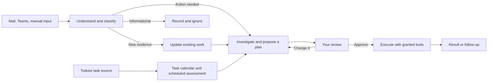

# Samwise Assistant

Samwise is a self-hosted personal assistant that turns messages, promises and requests into work you can review and approve. It follows incoming information, looks up the context, proposes a plan and uses connected tools to carry it out. New evidence can update existing work instead of creating another task.

Built for one owner, with a password-protected web app, a mobile-friendly board and Web Push notifications for proposals, questions and results. You choose the sources, tools and review policy.

[Get started](#get-started) · [Example flows](#example-flows) · [Integrations](#integrations) · [Security](#security-and-data) · [Development](#development)

## How it works

Samwise owns the workflow and its history. [Codex CLI API Gateway](https://github.com/MichalTichy/CodexCLI-API-Gateway) runs the AI agents in isolated containers and controls their access to Model Context Protocol (MCP) tools. Gateway is a separate project that can also be used independently.



A **work item** keeps the objective, evidence, questions, plan, approval and execution history together. **Playbooks** describe recurring situations: what matters, what to ignore, what to investigate and what a useful result looks like. Work can stay open while waiting for a reply or your action; saving a draft does not mean the email was sent.

## Example flows

Each flow needs the relevant accounts, tools and playbook. These are configurable scenarios, not integrations enabled by default.

- **Keep track of promises.** You write “I'll send the documents by Friday” in a work email. Samwise finds the commitment, checks for an existing task and proposes one in your task manager. A later sent email can provide evidence of fulfilment, allowing it to reassess the work and propose completing the matching task. It can only recognize completion from connected sources.
- **Prepare replies without sending.** A customer asks a question. Samwise retrieves the thread and shows you a proposed recipient and reply. After approval, it saves a draft in Outlook or another supported mailbox. You edit and send it yourself; sending permission can remain ungranted.
- **Find a meeting time.** A request arrives by email or Teams. Samwise checks connected calendars and proposes an available slot. After approval of the exact time and participants, it can create the event or a calendar-backed Teams meeting. The plan must make any invitation-sending effect clear.
- **Turn notices into follow-ups.** A parcel notice becomes a proposed pickup task with the actual deadline. A future check is scheduled on the linked internal task; the original Todoist deadline stays intact. Repeated notices can update existing work; informational messages can be ignored.

A deadline is different from a timed reminder. Web Push alerts draw attention to work-item events; task reminders need support and configuration in the connected task service. Setup checks how alerts actually reach you rather than treating a saved date as delivery evidence.

## Get started

You need Docker Engine with Compose (Docker Desktop on Windows/macOS), persistent storage and an OpenAI account with usable Codex access. Source builds also need Git and Python 3.11+, but no host .NET SDK. Microsoft 365/Teams connections may require an Entra app registration and administrator consent.

Start on your computer or deploy to a server/NAS. A local installation processes work only while its computer and Docker are running.

### Guided setup

Give an assistant that can read this checkout and run commands on the intended host the [setup guide](docs/ai-setup.md), or use the [samwise-setup skill](skills/samwise-setup/SKILL.md):

> Help me set up Samwise. Read docs/ai-setup.md in this checkout. Start with where my work comes from and what I want help with.

The assistant proposes a small first setup, reuses or deploys Samwise and Gateway, guides your sign-ins and verifies a useful example. You create your own Samwise account in the browser. Passwords do not belong in chat; your owner account, AI account and provider connections have separate sign-ins.

### Build and run a new installation

Source builds avoid dependence on the default private image registry. Clone both repositories as siblings. Until the setup changes are merged into the default branches, use these companion branches:

```bash
git clone --branch t3/opensource-readiness https://github.com/MichalTichy/Samwise-Assistant.git
git clone --branch codex/ai-assisted-setup https://github.com/MichalTichy/CodexCLI-API-Gateway.git
cd Samwise-Assistant
python scripts/ai_setup.py prepare --local-database --deployment-id samwise --gateway-source ../CodexCLI-API-Gateway
```

`prepare` generates missing service secrets in ignored `.env`, selects local image tags and configures the optional PostgreSQL service. It preserves existing credentials. Use this path with fresh storage; use the guide to reuse an existing deployment.

Create `.data/mcp-files` for shared files, then build and start:

```bash
docker compose -f compose.yaml -f compose.local.yaml -f compose.build.yaml build
docker compose -f compose.yaml -f compose.local.yaml -f compose.build.yaml up -d
```

On native Linux, set `DOCKER_GID` to the Docker socket's group before starting. See Gateway's [runner requirements](https://github.com/MichalTichy/CodexCLI-API-Gateway#prerequisites) for Docker compatibility and host-specific AppArmor setup.

The services now run, but account connections and agent settings still need configuration:

1. Run `python scripts/ai_setup.py registration-link`. Open the saved `.data/setup/owner-registration-link.txt` privately, create the owner account and verify sign-in. Clear `SAMWISE_OWNER_REGISTRATION_TOKEN` in `.env`, recreate `web` and remove the link file. Registration already stops working once the owner exists.
2. Open Gateway at `http://localhost:5050/admin` using the administrator credentials in private `.env`. Complete Codex sign-in, then run `python scripts/ai_setup.py provision` to create separate intake, planning and execution keys. Recreate `web` to load them.
3. Follow [connect Gateway and Samwise](docs/ai-setup.md#3-connect-gateway-and-samwise) to discover models, save stage settings, connect selected inputs/tools and create the first playbook. The helper does not choose all these settings automatically.
4. In Samwise at `http://localhost:8080`, review a harmless example, verify its result and clean up the test artifacts. Enable notifications on your intended device and verify receipt. Set an explicit `SAMWISE_WEB_PUSH_SUBJECT` contact if you left the legacy owner-email setting empty.
5. Follow the guide's closure step: blank both setup API keys, recreate `web` and `gateway`, and verify their setup routes return 404. Keep runtime keys and persistent volumes.

For every recreation, use the same `-f compose.yaml -f compose.local.yaml -f compose.build.yaml` options as startup. For existing PostgreSQL, prebuilt images, HTTPS, backups and updates, see [deployment](docs/deployment.md). Default registry images may require credentials; source builds are the alternative.

## Integrations

**Inputs** bring information into Samwise. **MCP tools** let agents investigate or act. Connecting an input does not automatically grant tools; registering an MCP server does not enable background ingestion.

| Connection | Built-in input | Optional agent tools |
| --- | --- | --- |
| Email | New received and sent mail via read-only IMAP; Microsoft 365 OAuth supported | Search threads, inspect attachments, save drafts; send only if granted |
| Microsoft Teams | Microsoft Graph ingestion for configured activity | Chat/channel context, transcripts, meetings and separately granted message writes |
| Todoist | Dated tasks synchronized into the task calendar | Find, create or complete tasks through a separate MCP connection |
| Calendar and contacts | No automatic input | Availability, event and contact operations through a connected provider |
| Manual | Web form and dedicated input API, including mobile Shortcuts | The tools granted for the selected work |

Companion projects worth connecting for these flows:

- [MCP.MailCalendarContacts](https://github.com/MichalTichy/MCP.MailCalendarContacts) packages a reviewed Adjutant build for Microsoft 365, Outlook.com, Google and generic IMAP/SMTP mail, plus supported calendar/contact providers. Account permissions and Gateway grants control reads, drafts, sending and other writes separately. Useful for reply drafts, calendar coordination and attachments.
- [MCP.Teams](https://github.com/MichalTichy/MCP.Teams) provides Teams chat, channel, calendar-backed meeting, call-history and transcript tools. Samwise's built-in Teams intake is independent. Call/transcript features may need additional tenant permissions.

Deploy these separately using their own instructions, register them in Gateway and grant exact tools to the appropriate profiles. Both use trusted private networking for MCP access; keep their endpoints private. Neither starts in Samwise's default Compose stack. Match their backend network configuration to Gateway, especially with a custom deployment ID.

The default stack includes filesystem (read-only shared folder), persistent memory and Playwright browser MCP servers. They still need registration and selected grants. Standard IMAP/SMTP and CalDAV alternatives are in [optional integrations](docs/deployment.md#optional-integrations).

Teams privacy matters: current intake supports exclusions, not an allowlist guaranteeing every new unselected chat remains unread. Lookup tools have their own scope. If this boundary does not meet your needs, leave Teams disconnected and forward selected information manually.

## Security and data

Samwise combines reviewable plans, separate credentials and restricted tool access:

- **Owner access.** ASP.NET Core Identity hashes the password and authenticates the owner with a cookie. A private one-time installation link creates the single owner; registration is unavailable afterward. There is no public signup, password-recovery or 2FA UI.
- **Separate permissions.** Intake and planning use profiles intended for classification and read-only investigation. Execution has its own key/project and explicit tool grants. Inspect actual catalogs, including native workspace tools, rather than trusting tool names or annotations. The enforcement mechanism is described below.
- **Review and changing evidence.** Human review is the default. Approval refers to the exact plan and work-item revision; new context can invalidate it. Execution checks its catalog snapshot and requires replanning if it changed. Optional automatic approval requires an explicitly eligible playbook, an assessment and a separate restricted execution profile.
- **Protected credentials.** Samwise protects provider passwords, tokens and caches with its persisted ASP.NET Core Data Protection key ring. Keep `.env`, provider volumes and backups private; companion services have their own storage protections. Temporary setup keys are separate from runtime keys, never granted to running agents, and removed after setup. Disabled setup routes return 404.
- **Audit and uncertain effects.** PostgreSQL retains input evidence, rendered prompts, structured responses, playbook snapshots, plans, reviews and execution history. Interrupted or uncertain execution is not blindly retried: reconcile its external result first to avoid duplicate actions.

### How unauthorized MCP calls are blocked

Gateway authenticates Samwise's API key and resolves its access to the selected project. That grant selects exact MCP servers and tools: only those are injected into the run's Codex configuration and exposed in its tool catalog. New tools require an explicit grant. The runner ignores user configuration, rules, apps and plugins that could otherwise introduce additional integrations.

For gateway-hosted MCP connections, the runner receives a short-lived token for a run-specific proxy session. Gateway keeps upstream MCP credentials and checks every `tools/call` against that session's enabled-tool allowlist **before forwarding it**. Calling an ungranted tool returns HTTP 403, even if the model guesses its name. Sessions are removed when the run finishes and also have an expiry. Advanced runner-hosted MCP connections receive their explicitly configured credentials and rely on the injected Codex tool restrictions rather than this proxy check.

For example, a planning key granted mail search but no send tool cannot invoke send through the gateway proxy. A plan requesting a send does not grant that permission; execution needs its separately configured key and tool grant.

### How runs are isolated

Each model call gets a short-lived Linux container running as a non-root user, with a read-only root filesystem, dropped Linux capabilities and CPU, memory and process limits. It receives a private workspace snapshot, never the live project artifact directory or Docker socket. Successful runs have their artifacts checked and committed; failed, cancelled and timed-out runs discard their workspace changes. This does not undo external effects already performed through MCP tools.

Inside the container, a Bubblewrap sandbox restricts model-generated commands to minimal runtime reads and writes in the workspace and bounded temporary storage. It blocks direct command networking and access to Codex's authentication directory, with a private process view to prevent reaching that directory through another process. The Codex process retains network access for inference and configured MCP connections; shell commands cannot use `curl` or similar commands to bypass MCP grants. Gateway-hosted MCP credentials stay in Gateway, and model-generated commands receive a restricted environment.

Gateway itself has Docker socket access, which is host-administrator authority. Keep the control plane private and trust its administrators, runner images and MCP servers. This is a personal deployment, not hostile multi-tenant isolation. See the [Gateway security model](https://github.com/MichalTichy/CodexCLI-API-Gateway#runtime-request-flow) for implementation details and deployment requirements.

Self-hosting stores application state on your infrastructure; inference is not offline. Relevant messages, prompts and tool results are sent to the configured AI service through Gateway. Connected providers receive the requests you authorize. Treat incoming messages and tool output as untrusted: review and limited grants reduce prompt-injection risk but do not make model decisions infallible.

For remote use, configure HTTPS and `SAMWISE_REQUIRE_HTTPS=true`, keep Gateway administration and unauthenticated private MCP endpoints off the public internet, and back up both databases and persistent volumes. Losing Data Protection keys makes protected credentials unreadable. [Deployment](docs/deployment.md) covers these settings and device notification requirements.

## Improve it with use

Start with one or two playbooks. After a few days, bring missed promises, unnecessary tasks or stale proposals to [samwise-tune-up](skills/samwise-tune-up/SKILL.md). It reviews evidence and helps adjust rules and connections. Tuning is iterative; configured integrations still need verification against your actual accounts and workflow.

## Development

Samwise uses .NET 10, Blazor Interactive Server, LumexUI/Tailwind CSS 4, PostgreSQL/Marten, ASP.NET Core Identity, Microsoft Agent Framework and the official MCP C# SDK. Every project has a README describing its boundary and components.

For host development, install the SDK selected by [global.json](global.json) and Docker. Set a private `OwnerAccount:RegistrationToken` through user secrets for `src/Samwise.Web`, then run:

```bash
dotnet run --project src/Samwise.AppHost
```

Aspire starts local PostgreSQL and the web app. Gateway is configured separately. Create the owner through `/register?token=<your-private-token>` on the local origin; configure agent endpoints with user secrets or environment variables. Follow the [Gateway contract](docs/gateway-agent-framework-compatibility.md) for the required APIs.

Generated CSS is committed. After changing styles or component classes, run `npm ci` and `npm run build:css` in `src/Samwise.Web`; release builds regenerate it.

```bash
dotnet restore Samwise.slnx
dotnet build Samwise.slnx --no-restore
dotnet test tests/Samwise.Tests/Samwise.Tests.csproj --no-build --no-restore
python -m unittest discover -s scripts -p test_ai_setup.py
```

Owner-registration integration tests additionally need `SAMWISE_IDENTITY_TEST_CONNECTION` pointing to a disposable PostgreSQL instance with database-creation permission. They create and remove their own test databases. See [setup validation](docs/setup/validation.md) and [onboarding validation](docs/setup/onboarding-validation.md) for actual checks and the limits of conversation simulations.

[Architecture](docs/architecture.md) · [Deployment](docs/deployment.md) · [Setup API](docs/ai-setup-api.md) · [Domain](src/Samwise.Domain/README.md) · [Workflow](src/Samwise.Logic/README.md) · [Web app](src/Samwise.Web/README.md)
