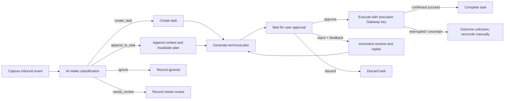

# Samwise Assistant

Samwise is a single-user personal assistant that turns incoming information into approved, executable work.

Version 1 accepts manual text in the password-protected Blazor UI. The text does **not** create a task directly. It enters the canonical inbound-event pipeline that future Outlook email, Microsoft Teams, and Todoist connectors will also use:



The authoritative state lives in PostgreSQL. AI calls are one-shot and stateless; Samwise stores the exact rendered prompt, structured result, tool-catalog versions, task revision, and approved plan needed for audit and continuation. An interrupted execution is never retried automatically because its external effects may already have happened.

## Technology

- .NET 10 and Blazor Interactive Server
- ASP.NET Core Identity with one owner account
- PostgreSQL with Marten for Samwise documents
- PostgreSQL with EF Core migrations for Identity
- .NET Aspire for local orchestration
- Microsoft Agent Framework `ChatClientAgent`
- Official OpenAI .NET connector pointed at Codex CLI API Gateway

## Projects

- `Samwise.Domain` — task, plan, inbound-event, comment, decision, and agent-work state
- `Samwise.Logic` — MediatR use cases, application ports, prompt rendering, and UI-facing models
- `Samwise.Infrastructure.Persistence.Marten` — Marten storage, named specifications, durable agent work, and the hosted worker
- `Samwise.Infrastructure.AgentGateway` — Microsoft Agent Framework/OpenAI transport for the Codex Gateway
- `Samwise.Infrastructure.AgentRuntimes` — selectable Gateway and deterministic demo implementations of `IAgentRuntime`
- `Samwise.Infrastructure.Persistence.Identity` — ASP.NET Core Identity storage, migration, and owner initializer
- `Samwise.Web` — authenticated Blazor composition root and presentation
- `Samwise.AppHost` — local PostgreSQL and web orchestration
- `Samwise.ServiceDefaults` — health checks, telemetry, and service discovery defaults
- `Samwise.Tests` — domain, prompt, and deterministic runtime tests
- `SharedInfrastructure/*` — repository-local copies of the installer, initializer, leader-election, specification, unit-of-work, and Marten building blocks used by the solution

See [architecture.md](docs/architecture.md) for the detailed design and [gateway-agent-framework-compatibility.md](docs/gateway-agent-framework-compatibility.md) for the Gateway contract.

## Run locally

Prerequisites: .NET SDK 10.0.301 or compatible and Docker Desktop.

Configure the first and only owner email with ASP.NET user secrets:

```powershell
dotnet user-secrets set "OwnerAccount:Email" "you@example.com" --project src/Samwise.Web
```

Start the Aspire host:

```powershell
dotnet run --project src/Samwise.AppHost
```

On first launch, open the login page and follow its **Set the password** link. V1 does not send email
or expose a self-service password-reset flow. Complete this first-run setup before exposing Samwise
outside your local machine.

Development defaults to the deterministic demo runtime, so the intake/plan/approval UI can be exercised without a running Gateway.

To use the Gateway, configure its three profiles through user secrets or environment variables. Intake and planning may share the planning key; execution must use its separate key.

```powershell
dotnet user-secrets set "AgentRuntime:Provider" "Gateway" --project src/Samwise.Web
dotnet user-secrets set "CodexGateway:Intake:ApiKey" "..." --project src/Samwise.Web
dotnet user-secrets set "CodexGateway:Intake:Model" "..." --project src/Samwise.Web
dotnet user-secrets set "CodexGateway:Planning:ApiKey" "..." --project src/Samwise.Web
dotnet user-secrets set "CodexGateway:Planning:Model" "..." --project src/Samwise.Web
dotnet user-secrets set "CodexGateway:Execution:ApiKey" "..." --project src/Samwise.Web
dotnet user-secrets set "CodexGateway:Execution:Model" "..." --project src/Samwise.Web
```

Base addresses and reasoning efforts have local defaults in `src/Samwise.Web/appsettings.json`; override them when the Gateway is hosted elsewhere.

## Verify

```powershell
dotnet restore Samwise.slnx
dotnet build Samwise.slnx --no-restore
dotnet test tests/Samwise.Tests/Samwise.Tests.csproj --no-build --no-restore
```

No database password, owner password, or Gateway API key is checked into this repository.
