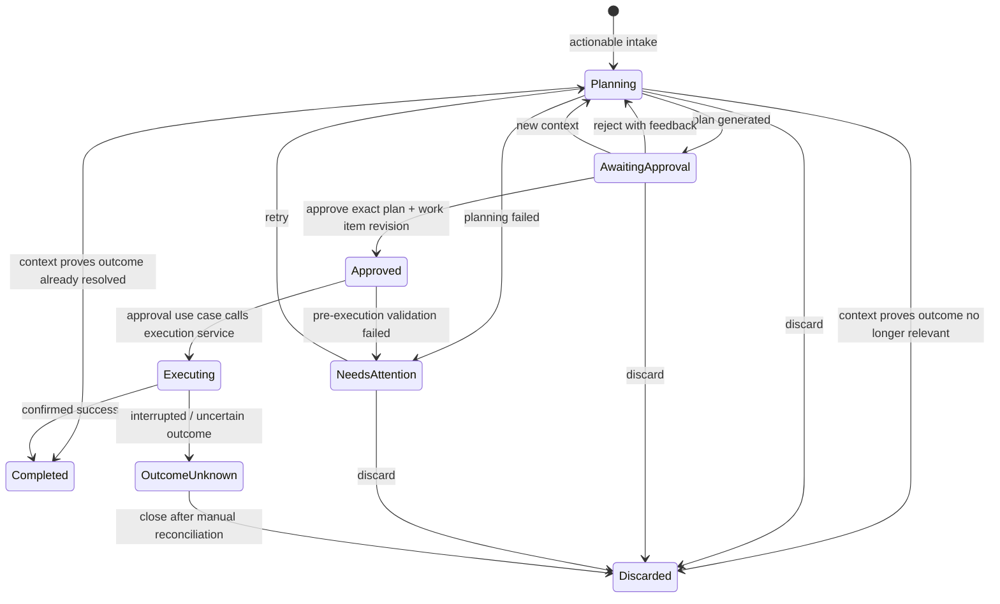

# Samwise V1 architecture

## Product boundary

Samwise is a personal, single-owner assistant—not a multi-tenant SaaS. V1 deliberately uses one deployable web process and one PostgreSQL database. Externally triggered MediatR use cases coordinate the short workflow through scoped services; there is no separate worker process, work-item queue, or separate processor. A small in-process timer is the external trigger for periodic email checks.

The web browser never calls the Codex CLI API Gateway. All Gateway credentials and calls remain server-side.

## Canonical intake

Each source has an external use case and creates its own typed inbound event:

```text
SubmitManualInputUsecase -> ManualInboundEvent
ProcessEmailsUsecase(NewSinceCheckpoint) -> EmailInboundEvent
ProcessEmailsUsecase(NewSinceCheckpoint) -> SentEmailInboundEvent
ProcessEmailsUsecase(Unread) -> EmailInboundEvent
ProcessTeamsInputsUsecase -> TeamsConversationInboundEvent | TeamsTranscriptInboundEvent
ProcessTodoistInputsUsecase -> TodoistTaskInboundEvent
```

Both operations call `InboundEventCaptureService`, which uses `Source + ExternalId` for connector-level deduplication. A deterministic key has a database unique constraint. The service stores an `InboundEvent` in `Pending` state and calls the inbound-event processing service, which performs classification and, when the result is actionable, planning.

Manual web text stores the entered text on `ManualInboundEvent`. The IMAP adapter stores account and message metadata plus a normalized body on `EmailInboundEvent` or `SentEmailInboundEvent`; their stable external identity is account ID, mailbox, UIDVALIDITY, and UID. Each derived event computes its intake text from its source fields. A related sent message is appended to an active Work Item like any other new context, invalidating the current plan before reassessment. Teams and Todoist sources follow the same rule. Connectors do not create or modify work items themselves.

Use cases represent external triggers only: a user action, an endpoint request, or a newly received input event. A use-case handler coordinates the integral steps of that operation by calling scoped processing, classification, planning, execution, and invocation-lifecycle services. It never sends another use case.

Reusable behavior belongs in services. Notifications are reserved for independent post-completion reactions that do not form part of the operation's required control flow; `WorkItemAttentionRequired` (see *Notifications*) is the only one.

Use-case handlers and workflow services use the copied shared-infrastructure `IRepository<T>` and `IReadOnlyRepository<T>` abstractions. Named specifications live beside their consuming feature in `Samwise.Logic`. Blazor pages execute public specifications through `IReadOnlyRepository<T>` for reads and send use cases for operations. They never depend on Marten directly.

The intake prompt receives the untrusted input and a compact list of active work item candidates. Its strict structured result is one of:

- `CreateWorkItem` — create a new actionable work item, then queue planning;
- `AppendToWorkItem` — append context to an exact candidate work item, increment its revision, invalidate its current plan, then queue planning;
- `Ignore` — keep the event in the audit log without a work item;
- `NeedsReview` — keep the ambiguous/failed event visible without guessing; the Input events page can queue classification again after the prompt or transient problem is corrected.

The selected existing work item must be both in the supplied candidate list and still active when the result is committed.

## Work item and plan lifecycle



The planner first returns `PlanRequired`, `AlreadyResolved`, or `NoLongerRelevant`. Terminal results require clear evidence in the supplied context and preserve the reason and planning invocation ID on the Work Item. `AlreadyResolved` becomes a normal completion; `NoLongerRelevant` becomes an audited discard. Neither fabricates a plan or runs execution.

A `WorkItemPlan` is Samwise’s own serializable plan snapshot, not an opaque Agent Framework session. It is nested in its work item document and contains technical steps, referenced qualified tool IDs, side-effect flags, success criteria, assumptions, risks, the exact work item revision, the selected playbook snapshot when one applies, structured snapshots of both tool catalogs, the agent-configuration identity/timestamp, the planning invocation ID, and its optional review. The invocation document owns the full rendered prompt and raw AI response, avoiding duplicate large strings inside every plan.

Each plan owns at most one `PlanReview`, either `Approved` or `Rejected`, with its feedback, source, and timestamp. A rejected plan retains its review after the work item advances to a new revision and receives a replacement plan. Discarding is a work-item lifecycle action rather than a plan review, so `DiscardedAt` and `DiscardedFrom` live directly on the work item and an abandoned current plan remains unreviewed.

Approval is a compare-and-set operation against `(WorkItemId, PlanId, WorkItemRevision)`. Rejection feedback and added context increment the work item revision and make the prior plan non-approvable. Before execution, Samwise fetches the execution tool catalog again; a changed catalog fails closed rather than running a stale approval.

## AI boundary

`IAgentRuntime` has three structured operations:

- classify an inbound event;
- generate a whole-work-item plan;
- execute one approved whole-work-item plan.

The production adapter keeps three fixed Gateway endpoint/credential profiles:

| Profile | Credential | Purpose |
|---|---|---|
| Intake | planning key | projectless classification; no MCP tools |
| Planning | planning key | planning project; normally no tools or only tools safe for the planner to invoke |
| Execution | execution key | execution project; exact MCP tools allowed after approval |

The finalized Gateway catalog contains only tools enabled for the authenticated key/project; it
does not expose a separate visible-only set. Samwise therefore fetches the execution catalog with
the execution profile and inserts that catalog into the planning prompt. The planner can describe
those future capabilities without receiving the execution credential.

Each call uses `IAgentRuntime`, implemented by a stateless Microsoft Agent Framework `ChatClientAgent` over the official OpenAI Chat Completions connector. Endpoint URLs and credentials are provider-neutral `AgentEndpoints` configuration; they currently point to Codex Gateway. No Agent Framework or native Codex session is persisted in V1. This avoids two competing sources of truth: all continuation context is assembled from Samwise’s stored work item, comments, prior plan, feedback, and tool catalog.

The model and reasoning effort are not deployment-profile settings. They are stored as exact catalog identifiers in each nested stage of the single agent-configuration document and can be changed from the authenticated UI. Reasoning effort is not an enum: supported values and defaults are model-specific and currently come from the Gateway extensions on the selected endpoint's `/v1/models` response. The selected values are passed through the standard OpenAI runtime for each invocation; endpoint URLs and API keys remain server-side deployment configuration.

Intake and planning calls have bounded transport retries because their credentials cannot perform mutations. Execution disables automatic SDK retries: a lost response after an MCP side effect is marked `OutcomeUnknown` and cannot be edited or retried automatically. A failure known to occur before execution starts is `NeedsAttention` and can safely create a replacement plan.

## Agent and playbook configuration

There is one `AgentConfiguration` document containing fixed nested settings for Intake, Planning, and Execution. Startup creates the complete document; stage saves require that root and update one nested setting instead of creating database documents on demand. The authenticated Agent settings page loads the Gateway catalog, restricts reasoning effort to the selected model's advertised values, and edits each stage's prompt with a placeholder legend and save-time validation. V1 intentionally has no configuration version history or live preview.

Playbooks are independent documents containing a name, description, enabled state, and update timestamp. Enabled Playbooks are rendered for Intake so known scenarios are recognized as actionable and for Planning so the plan follows their guidance. The planning agent selects at most one exact Playbook ID, or `null` when none clearly applies. Samwise validates that selection and stores the selected Playbook's ID, name, description, and timestamp inside the generated plan. Playbooks do not own Gateway credentials, tools, execution profiles, handovers, or a separate workflow lifecycle.

Every invocation stores its fully rendered prompt, so changing the current template does not erase what a past run saw.

## Samwise MCP boundary

`Samwise.Infrastructure.Mcp` hosts a stateless Streamable HTTP endpoint at `/mcp` inside the existing web process. It is a protocol adapter, not another application layer: reads use the same read-only repositories and specifications as the UI, while writes send externally triggered MediatR use cases. A dedicated `X-Api-Key` protects the endpoint independently of the owner's browser cookie.

The MCP exposes bounded Work Item and input-event lists, full item/event details, complete stored agent invocations, all Playbooks, and the nested agent settings with each stage's placeholder legend. Its mutations replace one complete stage prompt, create or update a Playbook, or explicitly replan an unexecuted Work Item while preserving its plan history. It cannot change Gateway credentials, email credentials, owner authentication, Work Item approval, or execution state. Prompt writes retain the existing model and reasoning effort and still pass placeholder validation.

Gateway remains the capability boundary. Planning should receive the Samwise read tools. The write tools belong only in the execution grant, so the planner can propose a self-tuning change but cannot apply it before approval. Historical plans and invocations retain their snapshots after configuration changes.

## Email input

The authenticated Configuration → Inputs → Emails page owns the polling interval, a global list of exact ignored-sender addresses, and individual IMAP accounts. Automatic processing is always active; disabling an account removes only that account from scheduled checks. The same page can test an account and manually process one or all enabled accounts.

`EmailInputConfiguration` is a singleton Marten document. `EmailAccount` is a separate document per mailbox because its check timestamps and error state change independently. Passwords and app passwords are protected with ASP.NET Data Protection before persistence and are never returned to the UI; the persisted key ring is shared with authentication cookies.

`Samwise.Infrastructure.Email.Imap` uses MailKit and never changes message flags. It owns the provider-neutral IMAP reader and password authentication; `Samwise.Infrastructure.Email.Microsoft365` contributes Microsoft device-code authorization and an XOAUTH2 authentication handler. Creating an account stores the current `UIDVALIDITY` and `UIDNEXT` independently for INBOX and the server-designated Sent folder; scheduled checks import all later UIDs and advance each checkpoint only after durable capture. Existing accounts establish a Sent checkpoint on their first check without replaying history. A changed UID validity establishes a fresh checkpoint without replaying that mailbox. The manual action searches only INBOX `UNSEEN` messages without changing either automatic checkpoint. The dedupe identity remains account ID, mailbox, UIDVALIDITY, and UID.

Received-email events snapshot read and answered state. For answered messages, the adapter opens the server-designated Sent folder read-only and finds up to five replies using `Message-ID`, `In-Reply-To`, and `References`; their normalized bodies are included in intake context. Sent-email events independently capture newly sent message bodies and attachment metadata for intake. Failure to discover Sent disables sent tracking without blocking INBOX capture. Attachment metadata is recorded without downloading attachment bodies. Exact ignored senders apply only to received mail and are recorded without an AI call, body download, or sent-reply lookup. Sending, full thread synchronization, and IMAP IDLE are outside V1.

## Todoist input

The authenticated Configuration → Inputs → Todoist page owns the API token, polling interval, lead time, overdue range, intake guidance, and ignored projects and labels. `TodoistInputConfiguration` is a singleton Marten document. Its token is protected with ASP.NET Data Protection and never returned to the UI.

`Samwise.Infrastructure.Todoist` lists active tasks through the Todoist API v1 and only reads. Every task whose due instant falls between `now − OverdueDays` and `now + LeadHours` becomes one `TodoistTaskInboundEvent`. All-day tasks are due at the start of their day. Floating times use the task timezone, then the Todoist account timezone. The external identity is the task ID plus its due value, so a reschedule or the next occurrence of a recurring task is a new input. Earlier occurrences of the same task (`ContextKey = todoist:task:<id>`) are supplied as linked context, so intake can append to their active work item. Tasks in ignored projects or carrying an ignored label are recorded without an AI call. The planning lead time means a plan can be waiting for approval before the task is due. Execution still runs at approval; there is no scheduled-execution state.

Samwise does not write to Todoist from the connector. Completing, commenting on, or creating tasks are ordinary plan steps that run through the Gateway Todoist MCP tools after approval. The Todoist task ID reaches planning and execution through the work item's source reference. This also allows **deferred actions**: an approved plan can create a Todoist task with a future due date, and when that task enters the lead window it returns as normal input. Samwise-created tasks get no special treatment, so a deferred task should be due later than the lead window if it is not meant to come back immediately.

## Notifications

Samwise tells the owner when a work item needs them through standard Web Push, which also reaches an iPhone once Samwise is added to the Home Screen (iOS 16.4+).

`WorkItemPlanningService` and `WorkItemExecutionService` call `IWorkItemAttentionNotifier` **after** persisting these transitions:

| Transition | Kind | Default |
|---|---|---|
| plan applied (`AwaitingApproval`) | `PlanAwaitingApproval` | on |
| planner question (`AwaitingUserInput`) | `QuestionAsked` | on |
| planning or pre-execution failure (`NeedsAttention`) | `NeedsAttention` | on |
| lost or uncertain execution result (`OutcomeUnknown`) | `OutcomeUnknown` | on (with needs attention) |
| execution succeeded | `Completed` | off |

The notifier publishes the MediatR `WorkItemAttentionRequired` notification and logs, never throws, so a push failure cannot change a workflow outcome. `WorkItemAttentionRequiredHandler` checks the singleton `NotificationSettings` document and sends one message per `PushDevice` with the work-item URL and a per-item tag, so a newer state replaces the older banner. Devices whose push service answers 404/410 are deleted, and other failures are recorded on the device.

`Samwise.Infrastructure.WebPush` implements the `IPushNotificationSender` port with Lib.Net.Http.WebPush (VAPID, aes128gcm). The VAPID key pair is generated once at startup into `PushApplicationKeys`, with the private key protected by Data Protection. The VAPID subject is `WebPush:Subject`, falling back to `mailto:` + the owner e-mail. Notification action buttons are not supported by iOS, so a tap opens the work item, and approval happens in the app's floating decision bar.

## Mobile / PWA

The web UI is an installable PWA: a `manifest.webmanifest`, Home Screen icons, and a root-scope `sw.js` that only handles `push` and `notificationclick`. Blazor Server needs a live circuit, so nothing is cached for offline use. Below 820px the sidebar becomes a top bar, a bottom tab bar, and a "More" sheet. The Board shows one column at a time behind tabs, and a work item keeps Approve / Reject in a floating bar at every screen width. The Configuration → Notifications page enables the current device. Its Enable button is bound in JavaScript, because iOS only shows the permission prompt inside the tap itself.

## UI

- **New input** — manual capture form and a four-step explanation of capture, triage, planning, and approval.
- **Board** — Todoist-inspired columns/cards for active work item states, including draft planning and awaiting approval.
- **Input events** — chronological source text, pending/final handling decision, classifier explanation, linked work item, and retry for events needing review.
- **Work item detail** — current plan, steps, tools, assumptions, risks, approve/reject/discard controls, comments, plan reviews, and recent agent activity.
- **Agent settings** — model, reasoning effort, prompt editor, and placeholder legend for each stage.
- **Playbooks** — create, edit, enable, and disable reusable planning guidance.
- **Configuration → Inputs → Emails** — polling interval, exact ignored senders, IMAP account management, connection tests, and manual unread processing.
- **Configuration → Notifications** — enable push on this device, choose which events notify, list and remove devices, and send a test.
- **Configuration → Inputs → Todoist** — API token, polling interval, lead time, overdue range, intake guidance, ignored projects and labels, connection test, and manual processing.
- **Account** — two Samwise-owned pages: password-only login and change password. Startup seeds the one owner from `OwnerAccount` configuration. There is no generated Identity UI, registration, email confirmation/recovery, external login, 2FA, or passkey flow.

Work item comments are first-class owned values inside the work item aggregate. This supports ordinary context and rejection feedback immediately, makes the work item revision and its new context one atomic document update, and lets a future Todoist projection treat comments as another command surface without changing the work item model.

## Future Todoist UI adapter

Todoist is already an input source (see *Todoist input*). The following two-way board mirror remains future work.

Samwise remains authoritative. A future adapter can mirror one Samwise work item into a dedicated Todoist board and store an `ExternalWorkItemLink` mapping. Plan snapshots can be posted as comments. Approval commands should be strict, revision-bound comment commands such as `/samwise approve <one-time-code>`, deduplicated by Todoist comment ID and routed into the same approve/reject/discard application commands as Blazor.

Ordinary Todoist comments become work item context and invalidate the current plan. Todoist completion must not implicitly mean approval.

## Persistence

- Marten schema `samwise`: versioned work item aggregate documents (including nested plans, selected playbook snapshots, plan reviews, comments, discard metadata, plan steps, and tool snapshots), polymorphic inbound events, email accounts, email-input configuration, agent invocations, the nested agent-configuration document, and playbooks.
- EF Core schema `identity`: the single password-authenticated ASP.NET Identity owner. Samwise uses Identity only for its password store and application cookie.
- Durable Data Protection keys: login cookies survive restarts.
- EF migrations initialize Identity; Marten creates or updates its document schema at startup. This is an intentional single-user V1 simplicity tradeoff.

The work item is the consistency boundary. It implements Marten numeric revisioning, so concurrent updates fail instead of silently replacing nested context or plan reviews. Each work item transition—including its comment, plan review, discard metadata, or plan—is persisted as one document update. Intake classification uses one ambient Marten transaction when it must update both an inbound event and a work item. Agent invocations remain separate because they are large operational audit records whose running/final states straddle an external call.

V1 assumes a single user and a single web process. It intentionally has no durable workflow queue: an external use case coordinates classification, planning, or execution services to completion in the same request. The in-process email poller triggers that same external email-processing use case. If durable background delivery or broader crash recovery becomes necessary later, it can be added around those services without changing the external use-case boundary or moving workflow rules into persistence.

## Code organization

The solution follows the useful Edifio conventions while retaining the single-process V1 deployment:

- externally triggered operations are explicit MediatR `*Usecase` request/handler pairs in `Samwise.Logic`;
- use cases coordinate integral follow-up steps by calling scoped application services directly;
- use cases never send other use cases, and behavior shared by multiple use cases belongs in services;
- notifications are reserved for independent reactions after an operation completes, not for mandatory workflow steps;
- Blazor pages use the copied shared `IReadOnlyRepository<T>` contract and public `*Specification` classes directly for reads;
- use-case handlers and workflow services use the copied shared `IRepository<T>`/`IReadOnlyRepository<T>` contracts for processing;
- specifications live beside their feature in `Samwise.Logic`; read-only `Get*Usecase` wrappers are intentionally absent;
- each infrastructure concern has its own project and `IInstaller` implementation;
- standard OpenAI execution lives in `Samwise.Infrastructure.AgentRuntimes`, while only nonstandard catalog discovery lives in `Samwise.Infrastructure.CodexGateway`;
- IMAP transport, password credential protection, and the in-process polling trigger live in `Samwise.Infrastructure.Email.Imap`; Microsoft identity and XOAUTH2 live in `Samwise.Infrastructure.Email.Microsoft365`; sender-ignore and workflow decisions remain in `Samwise.Logic`;
- EF migration/owner creation and prompt seeding are `InitializerBase` startup initializers; prompt defaults and initialization belong to `Samwise.Logic`, not the Marten adapter;
- custom Blazor pages, including login and password change, keep markup in `Page.razor` and behavior in `Page.razor.cs`;
- `Program.cs` is only the composition/pipeline entry point and discovers installers and initializers;
- required Edifio shared-infrastructure projects are copied under `SharedInfrastructure` and referenced only by repository-local project paths.

`Samwise.Infrastructure.Persistence.Marten` now contains only its installer and document mappings. It registers the copied shared Marten repository implementation; it contains no use cases, prompt behavior, worker, or domain workflow orchestration.
