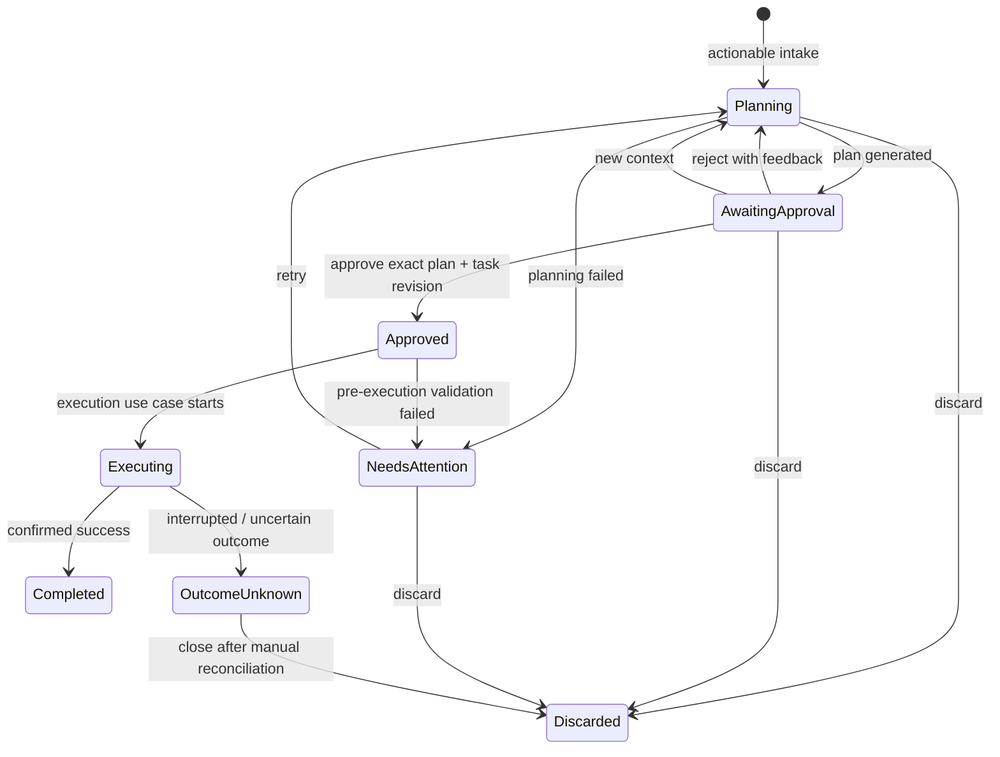

# Samwise V1 architecture

## Product boundary

Samwise is a personal, single-owner assistant—not a multi-tenant SaaS. V1 deliberately uses one deployable web process and one PostgreSQL database. MediatR use cases execute the short workflow directly; there is no background worker, work-item queue, or separate processor.

The web browser never calls the Codex CLI API Gateway. All Gateway credentials and calls remain server-side.

## Canonical intake

Every source sends the same `CaptureInboundEventUsecase` through MediatR:

```text
InboundEventCapture(Source, ExternalId, Text)
```

`Source + ExternalId` provides connector-level deduplication. A deterministic key has a database unique constraint. The capture use case stores an `InboundEvent` in `Pending` state and invokes the classification use case.

Manual web text uses `Source = "Web"`. A future email adapter will normalize an email into the same capture contract and use the provider message ID as `ExternalId`. Teams and Todoist follow the same rule. Connectors do not create or modify tasks themselves.

Use-case handlers use the copied shared-infrastructure `IRepository<T>` and `IReadOnlyRepository<T>` abstractions. Named specifications live beside their consuming feature in `Samwise.Logic`. Blazor pages and future connector adapters send use cases and never depend on Marten.

The intake prompt receives the untrusted input and a compact list of active task candidates. Its strict structured result is one of:

- `CreateTask` — create a new actionable task, then queue planning;
- `AppendToTask` — append context to an exact candidate task, increment its revision, invalidate its current plan, then queue planning;
- `Ignore` — keep the event in the audit log without a task;
- `NeedsReview` — keep the ambiguous/failed event visible without guessing; the Input events page can queue classification again after the prompt or transient problem is corrected.

The selected existing task must be both in the supplied candidate list and still active when the result is committed.

## Task and plan lifecycle



A `TaskPlan` is Samwise’s own serializable plan snapshot, not an opaque Agent Framework session. It is nested in its task document and contains technical steps, referenced qualified tool IDs, side-effect flags, success criteria, assumptions, risks, the exact task revision, structured snapshots of both tool catalogs, the prompt-template identity/version, and the planning invocation ID. The invocation document owns the full rendered prompt and raw AI response, avoiding duplicate large strings inside every plan.

Approval is a compare-and-set operation against `(TaskId, PlanId, TaskRevision)`. Rejection feedback and added context increment the task revision and make the prior plan non-approvable. Before execution, Samwise fetches the execution tool catalog again; a changed catalog fails closed rather than running a stale approval.

## AI boundary

`IAgentRuntime` has three structured operations:

- classify an inbound event;
- generate a whole-task plan;
- execute one approved whole-task plan.

The production adapter creates three immutable Gateway profiles:

| Profile | Credential | Purpose |
|---|---|---|
| Intake | planning key | projectless classification; no MCP tools |
| Planning | planning key | planning project; normally no tools or only tools safe for the planner to invoke |
| Execution | execution key | execution project; exact MCP tools allowed after approval |

The finalized Gateway catalog contains only tools enabled for the authenticated key/project; it
does not expose a separate visible-only set. Samwise therefore fetches the execution catalog with
the execution profile and inserts that catalog into the planning prompt. The planner can describe
those future capabilities without receiving the execution credential.

Each call uses a stateless Microsoft Agent Framework `ChatClientAgent` over the official OpenAI Chat Completions connector. No Agent Framework or native Codex session is persisted in V1. This avoids two competing sources of truth: all continuation context is assembled from Samwise’s stored task, comments, prior plan, feedback, and tool catalog.

Intake and planning calls have bounded transport retries because their credentials cannot perform mutations. Execution disables automatic SDK retries: a lost response after an MCP side effect is marked `OutcomeUnknown` and cannot be edited or retried automatically. A failure known to occur before execution starts is `NeedsAttention` and can safely create a replacement plan.

## Prompt configuration

There is one current prompt template for each stage: Intake, Planning, and Execution. The authenticated Prompts page provides a textarea, a placeholder legend, and save-time validation. V1 intentionally has no template version history or live preview.

Every invocation stores its fully rendered prompt, so changing the current template does not erase what a past run saw.

## UI

- **New input** — manual capture form and a four-step explanation of capture, triage, planning, and approval.
- **Board** — Todoist-inspired columns/cards for active task states, including draft planning and awaiting approval.
- **Input events** — chronological source text, pending/final handling decision, classifier explanation, linked task, and retry for events needing review.
- **Task detail** — current plan, steps, tools, assumptions, risks, approve/reject/discard controls, comments, decisions, and recent agent activity.
- **Prompts** — simple current-template editor and placeholder legend.
- **Account** — ASP.NET Core Identity login and owner settings. Public registration is not exposed. V1 has no email sender or self-service recovery flow; while the owner has no password, the login page displays a one-time password-setting link.

Task comments are first-class owned values inside the task aggregate. This supports ordinary context and rejection feedback immediately, makes the task revision and its new context one atomic document update, and lets a future Todoist projection treat comments as another command surface without changing the task model.

## Future Todoist UI adapter

Samwise remains authoritative. A future adapter can mirror one Samwise task into a dedicated Todoist board and store an `ExternalTaskLink` mapping. Plan snapshots can be posted as comments. Approval commands should be strict, revision-bound comment commands such as `/samwise approve <one-time-code>`, deduplicated by Todoist comment ID and routed into the same approve/reject/discard application commands as Blazor.

Ordinary Todoist comments become task context and invalidate the current plan. Todoist completion must not implicitly mean approval.

## Persistence

- Marten schema `samwise`: versioned task aggregate documents (including nested plans, comments, decisions, plan steps, and tool snapshots), inbound events, agent invocations, and prompt templates.
- EF Core schema `identity`: the single ASP.NET Identity owner.
- Durable Data Protection keys: login cookies survive restarts.
- EF migrations initialize Identity; Marten creates or updates its document schema at startup. This is an intentional single-user V1 simplicity tradeoff.

The task is the consistency boundary. It implements Marten numeric revisioning, so concurrent updates fail instead of silently replacing nested context or decisions. Each task transition—including its comment, decision, or plan—is persisted as one document update. Intake classification uses one ambient Marten transaction when it must update both an inbound event and a task. Agent invocations remain separate because they are large operational audit records whose running/final states straddle an external call.

V1 assumes a single user and a single web process. It intentionally has no durable workflow queue: an HTTP request runs classification/planning/execution to completion. If background delivery or crash recovery becomes necessary later, it can be added around the same use cases without moving workflow rules into persistence.

## Code organization

The solution follows the useful Edifio conventions while retaining the single-process V1 deployment:

- feature operations are explicit MediatR `*Usecase` request/handler pairs in `Samwise.Logic`;
- use-case handlers use the copied shared `IRepository<T>`/`IReadOnlyRepository<T>` contracts;
- reusable queries are named `*Specification` classes beside their feature in `Samwise.Logic`;
- each infrastructure concern has its own project and `IInstaller` implementation;
- the Codex Gateway transport and selectable agent-runtime implementations are separate infrastructure projects;
- EF migration/owner creation and prompt seeding are `InitializerBase` startup initializers; prompt defaults and initialization belong to `Samwise.Logic`, not the Marten adapter;
- custom Blazor pages keep markup in `Page.razor` and behavior in `Page.razor.cs`;
- `Program.cs` is only the composition/pipeline entry point and discovers installers and initializers;
- required Edifio shared-infrastructure projects are copied under `SharedInfrastructure` and referenced only by repository-local project paths.

`Samwise.Infrastructure.Persistence.Marten` now contains only its installer and document mappings. It registers the copied shared Marten repository implementation; it contains no use cases, prompt behavior, worker, or domain workflow orchestration.
