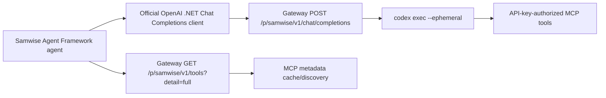

# Codex CLI API Gateway compatibility for Samwise and Microsoft Agent Framework

**Status:** Implementation brief
**Date:** 2026-08-17
**Audience:** Codex CLI API Gateway team and Samwise team
**Gateway repository audited:** `D:\Work\CodexCLI-API-Gateway`

## Executive decision

Samwise should use the official OpenAI .NET **Chat Completions** client, configured with the Codex CLI API Gateway URL and API key, and adapt that client to `Microsoft.Extensions.AI.IChatClient` for Microsoft Agent Framework.

The Gateway does **not** need to implement the entire OpenAI API. It needs to implement and continuously test the exact wire subset emitted by the pinned OpenAI .NET and Microsoft Agent Framework package versions used by Samwise.

For Samwise V1:

- Samwise owns tasks, task revisions, plan snapshots, approval, execution state, comments, and invocation receipts.
- Samwise uses independent, one-shot Agent Framework calls for Intake, Planning, and Execution; it does not preserve chat sessions in V1.
- The Gateway remains stateless for conversations and continues to use independent `codex exec --ephemeral` runs.
- The Gateway owns Codex execution, MCP configuration, MCP credentials, and per-request tool authorization.
- Gateway MCP tools remain internal to Codex. They are not exposed as Agent Framework function tools.
- Samwise retrieves a descriptive MCP tool catalog from the Gateway before planning.
- Planning and execution use separate Gateway API keys.
- Reliable Intake and Planning output is requested through standard Chat Completions JSON-schema `response_format`.

This is intentionally smaller than full Agent Framework Harness compatibility. Samwise must not register local Agent Framework function tools against this Gateway in V1.

## Terminology

The integration described here uses Microsoft **Agent Framework**, `Microsoft.Extensions.AI`, and the official OpenAI .NET client. It is not a legacy Bot Framework protocol.

Microsoft Agent Framework itself does not prescribe one HTTP schema. It delegates model calls to an `IChatClient`. When backed by the OpenAI Chat Completions adapter, that client emits the OpenAI Chat Completions schema.

## Target architecture



The preferred consumer endpoint is project-scoped:

```text
https://<gateway-host>/p/samwise/v1
```

The OpenAI client appends `/chat/completions`. Authentication remains:

```http
Authorization: Bearer <planning-or-execution-key>
```

Samwise calls the custom tool-catalog endpoint separately; the OpenAI client will not discover it automatically.

## Consumer-first compatibility strategy

Do not derive compatibility only from hand-written `curl` requests.

1. Pin the exact OpenAI .NET, `Microsoft.Extensions.AI.OpenAI`, and Microsoft Agent Framework package versions used by Samwise.
2. Construct the real Chat Completions client with the Gateway as its endpoint.
3. Capture the HTTP emitted for every Samwise scenario.
4. Commit sanitized request/response fixtures to Gateway tests.
5. Run an end-to-end test through the real client in Gateway CI.
6. Treat a package upgrade as a wire-contract change: update the capture and review the diff before merging.

At minimum, capture:

- Plain non-streaming chat.
- System/developer/user/assistant message history.
- Serialized and restored Agent Framework history followed by another turn.
- SSE text streaming, if Samwise enables streaming.
- JSON-schema structured output.
- Requests with no local tools.
- The request emitted with hosted web search disabled.
- The exact request produced if an accidental local Agent Framework tool is registered.

The last case must fail explicitly until function calling is deliberately implemented.

## Current Gateway behavior

The current Gateway is already adequate for basic text-only Chat Completions:

- `POST /v1/chat/completions` and `POST /p/{projectId}/v1/chat/completions` exist.
- Requests support `model`, `messages`, `stream`, `reasoning_effort`, and Gateway-specific `file_ids`.
- Text messages are flattened into one Codex prompt.
- Non-streaming responses use the standard `chat.completion` envelope.
- SSE responses use `chat.completion.chunk` and terminate with `data: [DONE]`.
- Usage is returned for non-streaming calls.
- Errors use an OpenAI-shaped `{ "error": { ... } }` envelope.
- API-key-specific MCP grants are resolved for every request.
- Codex execution is ephemeral and isolated.

Relevant implementation locations, relative to `D:\Work\CodexCLI-API-Gateway`:

| Area | Current location |
|---|---|
| Request DTO | `src/CodexGateway.Api/OpenAI/OpenAiContracts.cs:6-31` |
| Chat routes and response | `src/CodexGateway.Api/Endpoints/ChatCompletionsEndpoint.cs:15-96` |
| SSE response | `src/CodexGateway.Api/Endpoints/ChatCompletionsEndpoint.cs:99-175` |
| Message flattening | `src/CodexGateway.Api/OpenAI/PromptBuilder.cs:18-74` |
| Supported content parts | `src/CodexGateway.Api/OpenAI/PromptBuilder.cs:77-133` |
| Codex JSONL handling | `src/CodexGateway.Api/Codex/ContainerCodexRunner.cs:57-104` |
| Ephemeral CLI arguments | `src/CodexGateway.Api/Codex/ContainerRuntime.cs:708-735` |
| Tool authorization | `src/CodexGateway.Api/Infrastructure/McpCatalogService.cs:59-90` |
| Current tool list | `src/CodexGateway.Api/Endpoints/ToolsEndpoint.cs:39-51` |
| Existing rich MCP parser | `src/CodexGateway.Api/Codex/McpMetadataDiscoveryService.cs:240-275` |

### Current compatibility gaps

| Capability | Current status | Samwise V1 requirement |
|---|---|---|
| Plain text Chat Completions | Supported | Keep and contract-test |
| Multi-turn history replay | Supported as flattened messages | Contract-test with real client |
| Optional message `name` | Ignored | Accept if emitted by the pinned client |
| Non-stream response | Supported | Keep |
| SSE text response | Supported at completed-message granularity | Test client behavior |
| `response_format: json_schema` | Implemented in the in-progress Gateway worktree | Keep and contract-test |
| Detailed MCP catalog | Implemented through `detail=full` in the in-progress worktree | Keep and contract-test |
| Catalog visibility separate from invocation | Implemented in the in-progress worktree | Keep and authorization-test |
| OpenAI request `tools` | Ignored | Explicitly reject non-empty values |
| `web_search_options` | Ignored | Disable in Samwise and reject if non-empty |
| Assistant `tool_calls` | Unsupported | V1 non-goal |
| Tool-result messages | Unsupported | V1 non-goal |
| Responses API | Unsupported | V1 non-goal |
| Native Codex sessions/resume | Unsupported | Not required |

Unknown request members are currently ignored by default JSON deserialization. Silently ignoring a semantics-changing field such as `response_format` or `tools` can make a caller believe a guarantee was applied when it was not. The Gateway must either support those fields or reject them explicitly.

## Required change 1: JSON-schema structured output

### Request contract

Support the standard Chat Completions shape:

```json
{
  "model": "<model>",
  "messages": [
    {
      "role": "user",
      "content": "Classify this input."
    }
  ],
  "response_format": {
    "type": "json_schema",
    "json_schema": {
      "name": "samwise_intake_decision",
      "description": "The handling decision for one input event.",
      "strict": true,
      "schema": {
        "type": "object",
        "properties": {
          "decision": {
            "type": "string",
            "enum": ["discard", "create", "update", "needs_review"]
          },
          "reason": {
            "type": "string"
          }
        },
        "required": ["decision", "reason"],
        "additionalProperties": false
      }
    }
  }
}
```

Required V1 format:

- `response_format.type` must equal `json_schema`.
- `json_schema.name` is required and must meet a conservative identifier limit.
- `json_schema.schema` must be an object.
- `strict` may be accepted and treated as `true`; Samwise will send `true`.
- Put explicit limits on serialized size, nesting depth, property count, and string lengths.
- Reject remote references and unsupported schema features if Codex CLI cannot accept them reliably.
- Return OpenAI-style `400 invalid_request_error` for invalid or unsupported schemas.
- Do not silently downgrade to unstructured text.

`json_object` is not required for V1. Reject it clearly unless the team chooses to support and test it.

### Codex mapping

Codex CLI supports:

```text
codex exec --output-schema <schema-file>
```

Implementation outline:

1. Add typed `ResponseFormat`/`JsonSchema` request contracts.
2. Carry the schema through `CodexPrompt` and `CodexRunRequest`.
3. Write it into a Gateway-owned temporary directory inside the run workspace, not `artifacts`.
4. Mount or map it to a fixed container path such as `/workspace/.gateway/output-schema.json`.
5. Add `--output-schema <fixed-path>` to the Codex arguments.
6. Ensure the schema file is never persisted as a project artifact.
7. Parse the final assistant content as JSON before returning success.
8. If the final content is invalid, return a sanitized `502` rather than a successful structured response.

The normal Chat Completions response remains unchanged; `choices[0].message.content` contains a JSON string.

For the smallest initial implementation, support structured output with `stream: false`. Either implement and test structured streaming or reject `response_format` combined with `stream: true` using a clear `400`. Samwise Intake and Planning can use non-streaming calls.

## Required change 2: detailed MCP tool catalog for planning

Planning must know what the execution environment can do, including tools the planning credential is not permitted to invoke.

The existing endpoint returns server IDs, server names, and tool names only. Preserve that default response for backward compatibility and add an explicit detailed view:

```http
GET /p/samwise/v1/tools?detail=full
Authorization: Bearer <planning-key>
```

Recommended response:

```json
{
  "object": "list",
  "catalog_version": "sha256:<opaque-hash>",
  "data": [
    {
      "id": "todoist",
      "name": "Todoist",
      "version": "1.2.0",
      "tools": [
        {
          "id": "todoist/create_task",
          "name": "create_task",
          "title": "Create task",
          "description": "Creates a Todoist task.",
          "input_schema": {
            "type": "object"
          },
          "output_schema": null,
          "annotations": {
            "readOnlyHint": false,
            "destructiveHint": false,
            "idempotentHint": false
          },
          "can_invoke": false
        }
      ]
    }
  ]
}
```

Requirements:

- Tool identity is the pair `(serverId, toolName)`; expose a stable qualified ID because names can collide across servers.
- Return title, description, input schema, output schema, and MCP annotations when available.
- Return an opaque deterministic `catalog_version` derived from normalized visible metadata.
- Keep transport configuration, commands, arguments, URLs, environment-variable names, credentials, and secrets out of the response.
- Sort servers and tools deterministically.
- Preserve the existing names-only response when `detail` is omitted so existing tests and clients do not break.
- Treat tool metadata as descriptive data, never as permission to invoke the tool.

The Gateway already contains an unused `McpMetadataDiscoveryService` that parses server metadata, tool descriptions, input/output schemas, annotations, icons, and `_meta`. Register and reuse it rather than introducing a second MCP parser.

### Visibility versus invocation

The current API-key grant conflates discovery with invocation: `/v1/tools` shows only `EnabledTools`, and the same collection is injected into Codex.

Introduce two concepts:

- **Visible tools:** descriptions/schemas the caller may retrieve for planning.
- **Enabled tools:** tools injected into Codex and invocable during that request.

A backward-compatible state model can default `VisibleTools` to `EnabledTools` when it is absent.

Example Samwise configuration:

| Credential | Visible tools | Enabled/invocable tools |
|---|---|---|
| `samwise-planning` | Read and write tools needed to describe feasible plans | Safe read/search tools only |
| `samwise-execution` | Approved execution catalog | Approved read and mutation tools |

`McpCatalogService.ResolveAsync` must continue to use only enabled tools when building the runtime Codex configuration. Prompt instructions are not a security boundary.

Before executing an approved plan, Samwise retrieves the catalog again. If a required tool disappeared or materially changed, Samwise invalidates the plan instead of executing it.

## Required change 3: explicit unsupported-feature behavior

Until OpenAI function calling is intentionally implemented:

- Allow missing, null, or empty `tools` only if that matches the pinned client fixtures.
- Reject non-empty `tools` with `400` and `code: "unsupported_parameter"`.
- Reject `tool_choice` that requests a function.
- Reject assistant messages containing `tool_calls`.
- Reject `role: "tool"` messages.
- Reject `parallel_tool_calls` when it would change behavior.
- Reject non-empty `web_search_options`; Samwise uses Gateway-internal MCP/search capabilities instead.
- Identify the offending field through `error.param`.

Example:

```json
{
  "error": {
    "message": "Request-level OpenAI function tools are not supported by this Gateway endpoint.",
    "type": "invalid_request_error",
    "param": "tools",
    "code": "unsupported_parameter"
  }
}
```

This is safer than silently running Codex without tools that the Agent Framework caller expected to execute.

## Planning and execution credentials

Samwise uses two API keys for the same Gateway project:

### Planning key

- Can retrieve all plan-visible tool metadata.
- Can invoke only approved safe read/search MCP tools.
- Cannot invoke mutation tools, even under prompt injection.

### Execution key

- Is selected by Samwise only after approval of the exact task and plan revision.
- Can invoke only the explicitly configured execution MCP allowlist.
- Is never sent to the browser or included in Agent Framework session serialization.

Permissions must be resolved for every request. A prior request, project artifact, or model message must not expand later permissions.

## Agent Framework configuration boundary

Samwise should explicitly select the Chat Completions adapter. Do not allow a package default to switch the integration to the Responses API.

For V1, use a plain Agent Framework chat agent/session or a Harness configuration with every local function-producing feature disabled. Samwise owns plan/todo/mode state in its own domain model.

Do not register local `AITool` instances on the Gateway-backed chat client. In particular, the default Harness todo and mode providers expose model-facing functions such as `todos_add` and `mode_set`. Those require OpenAI `tools`/`tool_calls`, which are out of scope here.

If a Harness is retained, explicitly disable its hosted web-search capability (`DisableWebSearch = true`) because the OpenAI adapter can otherwise emit `web_search_options`. Use only the Gateway's configured MCP/search tools. Prefer a plain `ChatClientAgent` when no other Harness capability is needed.

Gateway-managed MCP tools are different: Codex discovers and invokes them inside the Gateway run, and the Gateway returns only the final assistant content.

## Session behavior

No Gateway conversation, Agent Framework session persistence, or native Codex session API is required.

- Keep `codex exec --ephemeral`.
- Samwise creates a fresh Agent Framework call for each Intake, Planning, and Execution operation.
- A later plan revision reconstructs its complete prompt from the canonical task, comments, previous plan, rejection feedback, and current tool catalog.
- Samwise persists the exact `TaskPlanSnapshot` presented for approval and the rendered prompt for every invocation.

Native `codex resume`, Gateway session ownership, expiry, migration, browsing, and durable Codex rollout storage are non-goals unless a real requirement appears later.

## Streaming

The Gateway currently emits OpenAI-shaped SSE, but Codex text is forwarded after a completed agent message rather than token by token.

Contract-test the real OpenAI .NET client for:

- Initial assistant-role chunk.
- Content reconstruction.
- Terminal `finish_reason`.
- Final `data: [DONE]`.
- Unicode split safety.
- Client cancellation and disconnect.
- Gateway failure after headers have started.

`stream_options.include_usage` is currently unsupported. Either implement it when emitted by the pinned client or ensure Samwise does not request it. Structured output may remain non-streaming in V1.

## Retry and side-effect safety

An execution request may mutate an external system and then fail before Samwise receives the final response. Transparent client retry could repeat that mutation.

For execution calls, one of the following must be true:

- Automatic HTTP retries are disabled in the OpenAI client pipeline, or
- Every downstream mutation uses a proven idempotency key and the Gateway preserves it across retries.

The V1 recommendation is to disable transparent retries for execution calls and move an uncertain result to `OutcomeUnknown`, which requires manual reconciliation and cannot be automatically rerun. Planning calls can use bounded retries because their Gateway key cannot mutate external systems.

## Implementation map

Suggested Gateway changes:

1. `OpenAiContracts.cs`
   - Add typed `response_format` contracts.
   - Add enough tool-related fields to detect and reject unsupported requests.
2. `ChatCompletionsEndpoint.cs`
   - Validate structured-output and unsupported-tool combinations.
   - Preserve existing response envelopes.
3. `CodexContracts.cs`
   - Carry the validated JSON schema with the run request.
4. `WorkspaceManager`/run workspace
   - Stage the schema in a Gateway-only temporary path.
5. `ContainerRuntime.cs`
   - Add `--output-schema` with a fixed container path.
6. `ContainerCodexRunner.cs`
   - Validate the final structured result before returning success.
7. `Program.cs`
   - Register the existing `McpMetadataDiscoveryService` or a small caching wrapper.
8. `ToolsEndpoint.cs`
   - Add the backward-compatible `detail=full` response.
9. Gateway state/admin contracts
   - Add visible-tool grants separately from enabled-tool grants.
10. Fake Codex and tests
    - Capture schema arguments and produce valid/invalid structured fixtures.

## Required tests

### Real-client compatibility tests

Create a small test project or fixture using the exact packages pinned by Samwise. It must point the official OpenAI Chat Completions client at a `WebApplicationFactory` Gateway and verify:

- Bearer authentication and project-scoped base URL.
- Plain non-streaming response deserialization.
- System, developer, user, and assistant text messages.
- Optional assistant/message `name` values if the pinned client emits them.
- Unicode, multiline text, and content arrays.
- Multi-turn history after Agent Framework session serialization/deserialization.
- SSE response reconstruction and completion.
- JSON-schema structured output deserialization.
- A non-empty local tool request fails with the documented error.

Commit sanitized golden HTTP fixtures for these requests.

### Gateway unit and end-to-end tests

- Valid JSON schema reaches Codex as `--output-schema` and the exact expected file.
- Invalid, oversized, too-deep, or unsupported schemas return `400`.
- Invalid model output cannot be returned as a successful structured response.
- The temporary schema file is not persisted into project artifacts.
- `response_format` is never silently ignored.
- Non-empty `tools`, function `tool_choice`, assistant `tool_calls`, tool-result messages, and `web_search_options` fail explicitly.
- The names-only tool endpoint retains its current exact shape.
- The detailed tool endpoint returns descriptions and schemas without secrets.
- Tool-catalog ordering and `catalog_version` are deterministic.
- Planning-key visibility may exceed its invocable set.
- Planning-key runtime arguments never contain mutation tools.
- Execution-key runtime arguments contain only its exact allowlist.
- Revoking a grant affects the next request immediately.
- Missing or invalid API keys return the existing OpenAI-style `401`.
- Model, timeout, queue, cancellation, and Codex failures remain sanitized.
- Two concurrent tasks cannot leak messages, files, schemas, project artifacts, or permissions.

### Samwise vertical-slice acceptance test

```text
Input event
  -> Intake call with planning key and JSON schema
  -> detailed Gateway tool-catalog lookup
  -> Planning call with planning key and JSON schema
  -> persist exact TaskPlanSnapshot and catalog version
  -> approve exact task/plan revision
  -> Execution call with execution key
  -> persist result or OutcomeUnknown
```

The test must prove that a planning prompt cannot invoke a write tool and that execution cannot invoke a tool outside its allowlist.

## Explicit non-goals for this implementation

- Full OpenAI API parity.
- `/v1/responses` or Conversations API.
- Native Codex session persistence or `codex resume`.
- Gateway-owned task, plan, approval, todo, or workflow state.
- OpenAI request-level function calling.
- Agent Framework Harness local tool execution.
- Exposing internal MCP calls as OpenAI `tool_calls`.
- Tool-call streaming deltas.
- Images, audio, log probabilities, multiple choices, or arbitrary sampling controls.
- Public session browsing, branching, archive, or migration APIs.

These can be added later only when a concrete Samwise requirement and acceptance test justify them.

## Delivery order

1. Commit the current Gateway source as a baseline. The inspected checkout is currently an unborn branch with all implementation files untracked.
2. Pin the Samwise OpenAI/Agent Framework package versions.
3. Add the real-client compatibility test and capture current baseline traffic.
4. Add explicit unsupported-tool validation.
5. Implement non-streaming `json_schema` response format.
6. Expose the detailed tool catalog and visibility/invocation split.
7. Configure planning and execution keys and add authorization tests.
8. Run the existing Gateway suite plus real-client and Samwise vertical-slice tests.
9. Publish the supported protocol subset in the Gateway README/OpenAPI document.

## Definition of done

The Gateway work is complete when:

- The pinned official OpenAI .NET Chat Completions client works without a custom chat transport.
- Microsoft Agent Framework can complete text, multi-turn-history, streaming, and typed Intake/Planning scenarios used by Samwise.
- Unsupported local Agent Framework tools fail explicitly.
- Planning receives complete, versioned descriptions of relevant execution tools.
- Planning and execution keys are enforced independently at the actual Codex process boundary.
- Structured outputs are schema-constrained by Codex and validated before success is returned.
- Existing file, artifact, isolation, queue, error, and MCP authorization tests remain green.
- The Gateway remains stateless with respect to AI conversations and Samwise workflow state.

## References

- [Microsoft Agent Framework: OpenAI-compatible endpoints](https://learn.microsoft.com/en-us/agent-framework/hosting/self-hosting/openai-endpoints)
- [Microsoft Agent Framework: Agent Harness](https://learn.microsoft.com/en-us/agent-framework/concepts/harness)
- [Microsoft Agent Framework: sessions](https://learn.microsoft.com/en-us/agent-framework/concepts/agents/conversations/session)
- [Microsoft Agent Framework source: `ChatClientAgent`](https://github.com/microsoft/agent-framework/blob/main/dotnet/src/Microsoft.Agents.AI/ChatClient/ChatClientAgent.cs)
- [Microsoft.Extensions.AI OpenAI adapter source](https://github.com/dotnet/extensions/blob/main/src/Libraries/Microsoft.Extensions.AI.OpenAI/OpenAIChatClient.cs)
- [OpenAI Chat Completions API](https://developers.openai.com/api/reference/resources/chat/subresources/completions/methods/create)
- [Codex CLI developer commands (`--output-schema` and `--ephemeral`)](https://developers.openai.com/codex/cli/reference/)
